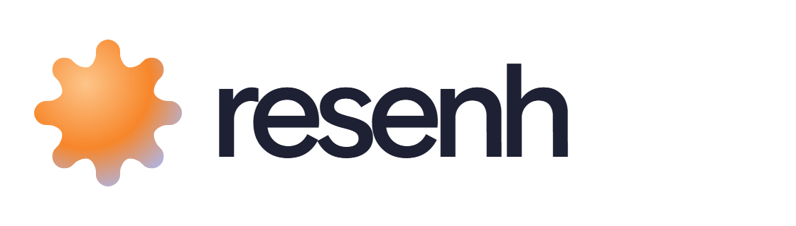
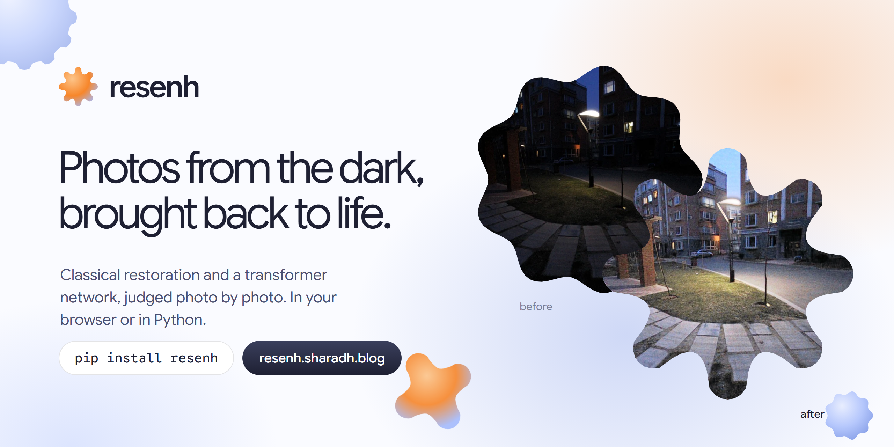
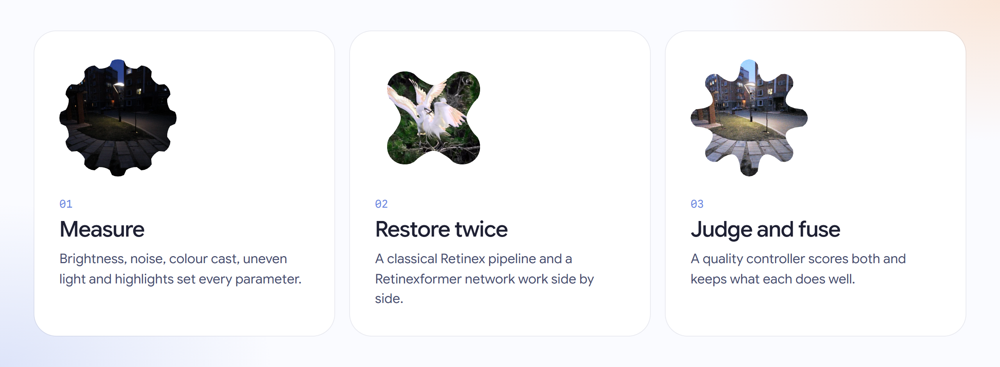
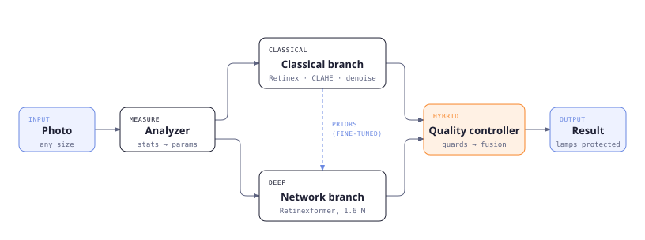

<p align="center">
  <picture>
    <source media="(prefers-color-scheme: dark)" srcset="https://raw.githubusercontent.com/SharadhNaidu/resen/main/assets/logo-dark.png">
    
  </picture>
</p>

<p align="center"><b>Robust low-light image restoration and enhancement.</b><br>
Photos from the dark, brought back to life: no blown-out lamps, no amplified noise, no invented colour.</p>

<p align="center">
  <a href="https://pypi.org/project/resenh/"></a>
  <a href="https://resenh.sharadh.blog"></a>
  <a href="https://huggingface.co/SharadhNaiduTrains/resenh"></a>
  <a href="https://colab.research.google.com/github/SharadhNaidu/resen/blob/main/notebooks/quickstart.ipynb"></a>
  <a href="https://github.com/SharadhNaidu/resen/actions/workflows/tests.yml"></a>
  <a href="https://github.com/SharadhNaidu/resen/blob/main/LICENSE"></a>
</p>

<a href="https://resenh.sharadh.blog"></a>

An adaptive classical pipeline and a transformer network run side by side, and a quality
controller decides, photo by photo, how much to trust each one.

**Try it:** [resenh.sharadh.blog](https://resenh.sharadh.blog). It runs entirely in your
browser, so your photo is never uploaded. ·
**Read the report:** [technical report (PDF)](https://github.com/SharadhNaidu/resen/blob/main/report/resenh_report_T46.pdf) ·
[evaluation tables](https://github.com/SharadhNaidu/resen/blob/main/eval_P1_T46.md)

---

## Contents
[How it works](#how-it-works) · [Install and use](#install-and-use) · [Results](#results) ·
[Web demo](#web-demo) · [Design principles](#design-principles) · [Assets](#assets) ·
[Releases](#releases) · [Reproduce](#reproduce) · [Team](#team) · [Credits](#credits)

## How it works





1. **Measure.** The analyzer reads seven statistics from the photo: brightness, share of dark
   pixels, sensor noise, colour cast, uneven lighting and highlights. Every later setting is
   computed from them.
2. **Classical branch.** It estimates illumination with max-RGB and a guided filter, then
   applies Retinex brightening, noise-adaptive denoising, CLAHE, white balance and highlight
   protection. It is predictable and never invents content.
3. **Network branch.** Retinexformer (ICCV 2023, 1.6 M parameters). The fine-tuned variants
   also take the classical illumination map and Retinex output as extra input channels.
4. **Quality controller.** It scores both outputs for newly blown highlights, colour shift,
   lost edges and noise amplification, then blends them with weights
   ∝ prior · exp(−penalty / T). On clean benchmarks it follows the network. On photos where the
   network misbehaves, it falls back to the classical result.

Every stage comes back with the result (`res.stages`, `res.decision`), and the web demo shows
them too. The [design document](https://github.com/SharadhNaidu/resen/blob/main/docs/design.md) has the full detail.

## Install and use

```bash
pip install "resenh[dl]"     # hybrid: classical + network (PyTorch)
pip install resenh           # classical only: numpy + OpenCV, no PyTorch
```

```python
import resenh

res = resenh.enhance("night.jpg")      # path, URL, bytes, PIL image or NumPy array
res.save("night_restored.png")
res                                    # in Jupyter, Colab or Kaggle: before / after
print(res.summary())                   # what it measured, chose and why
res.show(stages=True)                  # every intermediate image

resenh.enhance("night.jpg", mode="classical")    # also "dl", "hybrid" or "auto"
resenh.enhance("night.jpg", preset="benchmark")  # no noise gate: best on clean benchmark images
resenh.enhance_folder("photos/", "restored/")    # a whole folder, with a progress bar
```

```bash
resenh enhance night.jpg -o restored.png
resenh enhance photos/ -o restored/ --mode hybrid
resenh bench --device cuda             # latency at ~1 MP
resenh --env                           # versions, device and cached weights
resenh app                             # Gradio UI at http://localhost:7860
```

Weights download on first use from Hugging Face. They are SHA-256 verified and cached in
`~/.cache/resenh`. A [quickstart notebook](https://github.com/SharadhNaidu/resen/blob/main/notebooks/quickstart.ipynb) runs top to bottom on
Colab or Kaggle, with or without a GPU.

## Results

Plain RGB PSNR on the saved 8-bit image. There is no ground-truth brightness correction, no
per-image knobs, and no checkpoint selected on the test set. Our harness reproduces the official
Retinexformer checkpoints exactly (25.15 / 22.79 / 25.67 dB). Full tables with 95% confidence
intervals, SSIM, LPIPS, NIQE, noise and edge metrics are in [`eval_P1_T46.md`](https://github.com/SharadhNaidu/resen/blob/main/eval_P1_T46.md).

| PSNR (dB) ↑ | LOL-v1 (15) | LOL-v2-Real (100) | LOL-v2-Syn (100) | LSRW, unseen test (50) |
|---|---|---|---|---|
| Classical branch | 16.75 | 17.44 | 16.83 | 16.15 |
| Deep learning only (Retinexformer) | 25.15 | 22.79 | 25.67 | 17.19 |
| **resenh hybrid** | **25.13** | **22.82** | **25.35** | **19.26** |

- **LOL rows:** the hybrid uses the official per-benchmark backbone with the `benchmark` preset.
- **LSRW:** the hybrid uses the generalist model, which is the package default. That model was
  trained on LOL plus LSRW train, so this is in-domain for it. It was chosen on LSRW validation
  before the test set was scored.
- **Latency for a 1 MP photo:**

  | Hardware | Classical | Network | Hybrid |
  |---|---|---|---|
  | RTX 4070 laptop GPU | 0.38 s | 0.49 s | 1.9 s |
  | Laptop CPU | | | 5.0 s |
  | Laptop browser with WebGPU | | | about 6 s |

- **Further reading:** the [ablation](https://github.com/SharadhNaidu/resen/blob/main/docs/ablation.md) and the
  [protocol decisions](https://github.com/SharadhNaidu/resen/blob/main/docs/devlog/protocol-decision.md).

## Web demo

[resenh.sharadh.blog](https://resenh.sharadh.blog) has no backend. It runs the **same Python
package** inside the browser:

- **[Pyodide](https://pyodide.org)** runs the `resenh` wheel: the analyzer, classical branch and
  controller.
- **[ONNX Runtime Web](https://onnxruntime.ai)** runs the network, on WebGPU when available and
  multi-threaded WebAssembly otherwise.
- **Cloudflare** hosts it as static files, so nothing sleeps, queues or sees your photo. The
  first visit downloads about 40 MB, which is then cached.

The site is React 19, Vite, Tailwind CSS 4 and [shadcn/ui](https://ui.shadcn.com) (in `site/`).
Rebuild and deploy with:

```bash
bash deploy/build_web.sh && (cd site && npm ci && npm run build) && npx wrangler deploy
```

## Design principles

**Engineering**
- **Measure before you touch.** Every parameter follows from measured image statistics, with
  thresholds fitted on training and validation data, never on test.
- **Two opinions and a judge.** A predictable classical result and a learned result are both
  computed, and a transparent controller picks the blend. Nothing is a black box: every stage
  and score is returned.
- **Honest numbers.** Plain PSNR, pre-registered checkpoints, and an incident log for results
  that went against us (`docs/devlog/protocol-decision.md`).
- **Runs anywhere.** One code path covers CPU, CUDA, a notebook and a browser tab. PyTorch is
  optional.

**Visual design** (web demo and report)
- **Palette.** A white base (`#FAFBFF`) with a blue-hour palette: periwinkle `#A5BBFC` /
  `#6A88E2`, a sunrise accent `#F7862A` / `#FDC58A` and navy ink `#1E2033`. The gradients are
  inspired by Sarvam AI's brand work.
- **Shapes.** Material 3 Expressive shapes (flower, cookie, clover, burst), generated as polar
  curves in `site/src/lib/shapes.ts`, used as image masks and quiet ornaments.
- **Type.** Google Sans Flex, with Google Sans Code for code and numbers.
- **Components.** shadcn/ui components with M3 state layers and segmented buttons. Accessible
  by default: keyboard slider, visible focus, reduced-motion support and phone-first layout.
- **Figures.** Hairline rules, one accent per figure and no shadows.

## Assets

| Asset | Where |
|---|---|
| Network weights: `resenh-light-general` (default), `-lolv1`, `-lolv2-real`, `-lolv2-syn` | [huggingface.co/SharadhNaiduTrains/resenh](https://huggingface.co/SharadhNaiduTrains/resenh), SHA-256 pinned in `src/resenh/models/weights.py` |
| Official Retinexformer checkpoints (fallback and DL-only mode) | same repository, original MIT licence |
| In-browser models (`resenh-web-hybrid.onnx`, `resenh-web-dl.onnx`, 6.8 MB each) | same repository, `web/`; built by `deploy/export_onnx.py` |
| Technical report | [`report/resenh_report_T46.pdf`](https://github.com/SharadhNaidu/resen/blob/main/report/resenh_report_T46.pdf), built by `report/build_report.py` |
| Evaluation tables, ablation | [`eval_P1_T46.md`](https://github.com/SharadhNaidu/resen/blob/main/eval_P1_T46.md), [`docs/ablation.md`](https://github.com/SharadhNaidu/resen/blob/main/docs/ablation.md) |
| Logo, banner, illustrations | `assets/` (rendered by `assets/build_assets.py` from the site's design system) |
| Architecture diagram | [`docs/architecture.svg`](https://github.com/SharadhNaidu/resen/blob/main/docs/architecture.svg) |
| Figures and example photos | `report/fig/`, `docs/figures/`, `site/public/examples/` (from the public DICM, LIME, MEF, NPE and VV test sets) |
| Quickstart notebook | [`notebooks/quickstart.ipynb`](https://github.com/SharadhNaidu/resen/blob/main/notebooks/quickstart.ipynb) |

## Releases

| Version | Date | Changes |
|---|---|---|
| **0.1.2** | 2026-11-07 | The generalist model (LOL + LSRW) becomes the default: +1.9 dB on LSRW test. Fine-tuned v1 and Real weights published. *Tagged in the repo; PyPI upload pending.* |
| 0.1.1 | 2026-11-07 | Friendlier API: `res.save / show / compare / summary / stages`, notebook display, URL and file-like inputs, `enhance_folder`, `download_weights`, `info`, `resenh --env`, folder input in the CLI, `python -m resenh` |
| 0.1.0 | 2026-11-07 | First release: classical, DL and hybrid modes, CLI, Gradio app and evaluation harness |

Every merge to `main` is tested on Python 3.10–3.12, on Linux and Windows. Publishing a GitHub
release uploads to PyPI through trusted publishing (`.github/workflows/`).

## Reproduce

```bash
git clone https://github.com/SharadhNaidu/resen && cd resen
pip install -e ".[dl,eval,train,dev]"
python -m kaggle datasets download -d ohmahler91/lolv1-and-lolv2 -p data/raw/lol --unzip
python -m kaggle datasets download -d bjzh123/lsrw123 -p data/raw/lsrw --unzip
python -m kaggle datasets download -d mijancse12/onedrive-1-6-13-2026 -p data/raw/unpaired --unzip
python training/data_prep.py          # count checks, scene-grouped splits, de-duplication
bash training/queue.sh                # per-benchmark fine-tunes and ablations
python eval/run_eval.py --bench lolv1 lolv2_real lolv2_syn \
  --methods classical "net:retinexformer-{bench}" "hybrid-bench:retinexformer-{bench}" --niqe
python eval/make_report.py            # eval_P1_T46.md and docs/ablation.md
python report/build_report.py         # the technical report
pytest
```

| Path | What |
|---|---|
| `src/resenh/` | the package: `analysis`, `classical/`, `models/`, `controller`, `pipeline`, `web`, `cli`, `app` |
| `training/`, `eval/` | training, evaluation harness and report generators |
| `site/`, `deploy/` | the web demo and its build and deploy scripts |
| `report/`, `docs/` | technical report, design document, ablation and development log |

## Team

Team **V-Max** (T46), section E, problem P1.

| Member | USN |
|---|---|
| Sharadh Naidu | 1RUA24CSE0421 |
| Shivani | 1RUA24CSE0430 |
| S. V. Swamy | 1RUA24CSE0468 |
| Sumukha K | 1RUA24CSE0483 |

## Credits

- [Retinexformer](https://github.com/caiyuanhao1998/Retinexformer): Cai et al., ICCV 2023 (MIT)
- GT-mean loss: Liao et al., ICCV 2025
- LIME: Guo et al., TIP 2017
- Guided filter: He et al., TPAMI 2013
- Evaluation audit: arXiv 2610.38121
- Datasets: LOL, LOL-v2, LSRW, DICM, LIME, MEF, NPE and VV

Enhanced photos can contain invented detail, so do not use them as evidence.
MIT licence.
