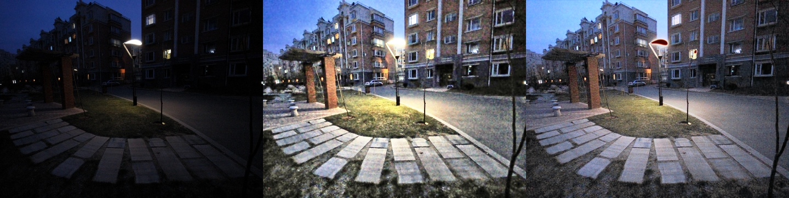

# resenh: robust low-light image restoration and enhancement

`resenh` brightens dark, noisy, colour-shifted photos without blowing out lamps, amplifying
noise or inventing colours. It combines three things:

- **A classical branch:** illumination estimation, Retinex, CLAHE, edge-preserving denoising
  and colour correction, with every parameter adapted per image.
- **A deep network:** Retinexformer (ICCV 2023) fine-tuned with the GT-mean loss, taking the
  classical results as extra inputs.
- **A quality controller:** checks every candidate output for over-exposure, colour shift,
  detail loss and noise amplification, and fuses them.


| Input | Classical branch | Hybrid (final) |
|---|---|---|
|  | | |

## Install

```bash
pip install "resenh[dl]"        # classical + deep hybrid (PyTorch)
pip install resenh              # classical only (numpy + OpenCV, no PyTorch)
pip install "resenh[app]"       # + Gradio web app
pip install "resenh[eval]"      # + LPIPS / NIQE metrics
```

From source: `git clone https://github.com/SharadhNaidu/resen && cd resen && pip install -e ".[dl,app,eval,dev]"`.
Weights are downloaded and checksum-verified on first use (cached in `~/.cache/resenh`).

## Use

```python
import resenh

res = resenh.enhance("night.jpg")                 # adaptive hybrid (default)
resenh.save_image(res.image, "night_enhanced.png")
res.intermediates["illumination"]                 # every stage is inspectable
res.decision                                      # controller weights and guard scores
res.stats, res.params                             # analyzer measurements → chosen parameters

resenh.enhance("night.jpg", mode="classical")     # no deep learning
resenh.enhance("night.jpg", mode="dl")            # network only
```

```bash
resenh enhance night.jpg -o out.png --save-intermediates stages/
resenh bench --device cpu                          # latency at ~1 MP
resenh app                                         # web UI at http://localhost:7860
```

**One command with Docker:** `docker build -t resenh . && docker run -p 7860:7860 resenh`

## Results
Full tables with all metrics and 95% bootstrap CIs are in
[`eval_P1_T01.md`](eval_P1_T01.md). The ablation is in [`docs/ablation.md`](docs/ablation.md)
and the failure analysis in [`docs/failures.md`](docs/failures.md).

**Protocol.**
- Plain RGB PSNR. No GT-mean correction and no test-time brightness knobs.
- Checkpoints are fixed in advance (`docs/devlog/protocol-decision.md`); none is selected on
  the test set.
- Train and test on the same benchmark only. The LOL-v1/v2 overlap is documented.
- Our harness reproduces the official Retinexformer checkpoints exactly: 25.15 / 22.79 /
  25.67 dB, matching the published audit.

## Reproduce

```bash
pip install -e ".[train,dev]"
python -m kaggle datasets download -d ohmahler91/lolv1-and-lolv2 -p data/raw/lol --unzip
python -m kaggle datasets download -d bjzh123/lsrw123 -p data/raw/lsrw --unzip
python -m kaggle datasets download -d mijancse12/onedrive-1-6-13-2026 -p data/raw/unpaired --unzip
python training/data_prep.py                 # verify counts, scene-grouped val splits, dedup
# official Retinexformer weights → weights/retinexformer/ (see src/resenh/models/weights.py)
bash training/queue.sh                       # fine-tune per benchmark + ablations
python eval/run_eval.py --methods classical "dl:retinexformer-{bench}" ...
python eval/make_report.py                   # writes eval_P1_T01.md, docs/ablation.md
pytest
```

## Project layout

| Path | What |
|---|---|
| `src/resenh/` | the package: `io`, `analysis`, `classical/`, `models/`, `controller`, `pipeline`, `metrics`, `viz`, `cli`, `app` |
| `training/` | data preparation, training script and GPU queue |
| `eval/` | evaluation harness and report generator |
| `docs/` | design document, architecture diagram, ablation, failure analysis, development log |
| `app/` | Space entry point and example images |

## Credits
- Retinexformer: Cai et al., ICCV 2023 (MIT), [repo](https://github.com/caiyuanhao1998/Retinexformer).
- GT-mean loss: Liao et al., ICCV 2025.
- LIME: Guo et al., TIP 2017.
- Guided filter: He et al., TPAMI 2013.
- Evaluation audit: "What Does LOL Measure?", arXiv 2610.38121.
- Datasets: LOL (Wei et al. 2018), LOL-v2 (Yang et al. 2021), LSRW (Hai et al. 2023),
  DICM, LIME, MEF, NPE and VV.

## Limitations and responsible use
See the [design document §8](docs/design.md#8-limitations-and-ethics). In short, enhanced
images can contain hallucinated detail and **must not be used as forensic evidence**. The
training data is small and mostly indoor.

## License
MIT
