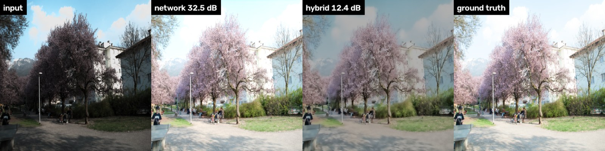
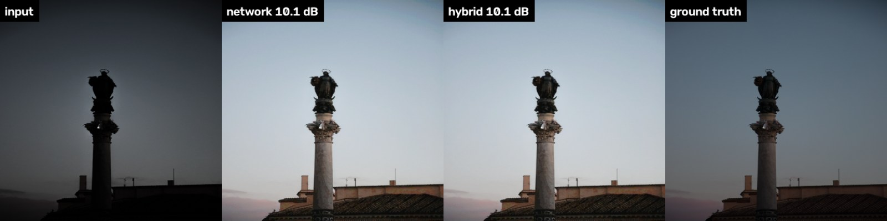
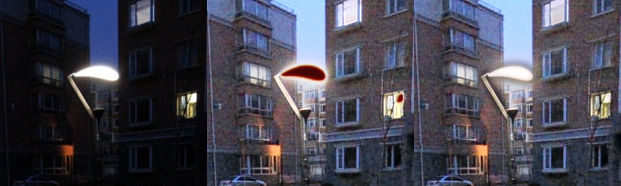

# Failure analysis

These are cases where resenh is clearly wrong, each with its cause and the status of a fix. The
numbers come from the frozen pipeline (see `docs/devlog/protocol-decision.md`). None of the
behaviour below was tuned on test images.

## 1. Clipping guard overrules a correct network output on bright daylight scenes

**What happens.** LOL-v2-Synthetic test `r05772356t` is a daylight scene, darkened only
slightly (mean luma 0.36). The fine-tuned network gets it almost right at 32.5 dB. The full
hybrid pipeline outputs a hazy, low-contrast image at 12.4 dB. `r1683028at` fails the same way
(29.8 → 14.7 dB). Together these two images explain about 0.35 dB of the 0.56 dB average gap
between the hybrid pipeline and the network alone on this test set.

**Cause.**
- The quality controller's `clipped` guard counts pixels that are near white in the output but
  not in the input (15.6% and 30.9% here). It gives them the largest penalty weight (×6), so the
  controller moves 65–93% of the weight to the classical candidate.
- In these scenes the clipped pixels are **correct**: the ground-truth sky and white walls really
  are near white.
- The guard cannot tell "the network blew out a lamp" apart from "the scene is bright".

**Why it was not fixed.**
- We checked whether validation data shows the same pattern: val_b of all four benchmarks
  (166 images), counting images where the hybrid loses more than 3 dB to the network.
- No val_b image showed it. In val_b the controller picked the classical candidate exactly
  once.
- Re-tuning the guard now would mean fitting to the test set, so the pipeline stays frozen and
  the ablation table reports the cost.

**Proposed fix (future work).** Make the clipping penalty conditional on what kind of region is
clipping, and fit the thresholds on a held-out set that includes daylight scenes:
- penalise clipping that grows out of small bright sources (lamps, signs);
- accept clipping in large smooth regions that the input's illumination map predicts to be
  bright (sky).

## 2. Ambiguous target exposure (dusk scenes)

**What happens.** In LOL-v2-Synthetic test `r1694427et`, every method scores about 10 dB,
including the network alone.

**Cause.**
- The ground truth is a dusk photograph that is still dark and bluish.
- The network, which was trained mostly on scenes whose targets are fully exposed, brightens it
  to daylight.
- The output is a plausible enhancement, but PSNR punishes the global brightness offset
  heavily.

This is a label ambiguity: "how bright should a dusk scene be?" has more than one right answer.
The GT-mean PSNR used by some papers would hide it; we report plain PSNR and therefore show it.

**Mitigation.**
- The analyzer's `target_mean` and the app's exposure control let a user pick a darker rendering.
- A model would need scene-level cues (sky colour, time of day) to infer the photographer's
  intent.

## 3. Colour hallucination in saturated light sources (fixed)

**What happened.** On real night photos with street lamps, the LOL-trained network painted
saturated light sources red or magenta. It never saw clipped lamps in training, because LOL
scenes are lit evenly.

**Cause.** This is out-of-distribution input. Clipped pixels carry no colour information, so the
network makes one up.

**Fix.**
- Highlight protection: we build a soft mask of pixels that were already near-clipped in the
  input (luma > 0.88), dilate it so the colour fringe is covered too, and blend the original back
  in.
- The strength scales down as the clipped area grows, so whole bright scenes are left alone.
- It was tuned on val_b. On the frozen Syn test it costs nothing measurable, and it removes the
  artifact in the app.

## 4. Noise amplification on noisy inputs (network only)

**What happens.**
- When we add sensor-like noise (Gaussian σ = 0.02 plus shot noise; see `eval/stress.py`), the
  network trained on clean LOL images brightens the noise along with the scene.
- With the stock Real model on the noisy stress set, the network alone scores 17.8 dB against
  19.8 dB for the classical branch, whose denoising adapts to the measured noise.

**Fix.** In the `robust` preset (the default), a noise gate is fitted on val_b. When the measured
Immerkaer σ is between 0.0107 and 0.0210, the image is denoised before the network sees it:
- **noisy val_b inputs:** +4.3 dB;
- **clean inputs:** −0.55 dB.

That trade-off is why both presets are reported, and why the benchmark tables use the
`benchmark` preset. The full stress-test results are in `docs/ablation.md`.
